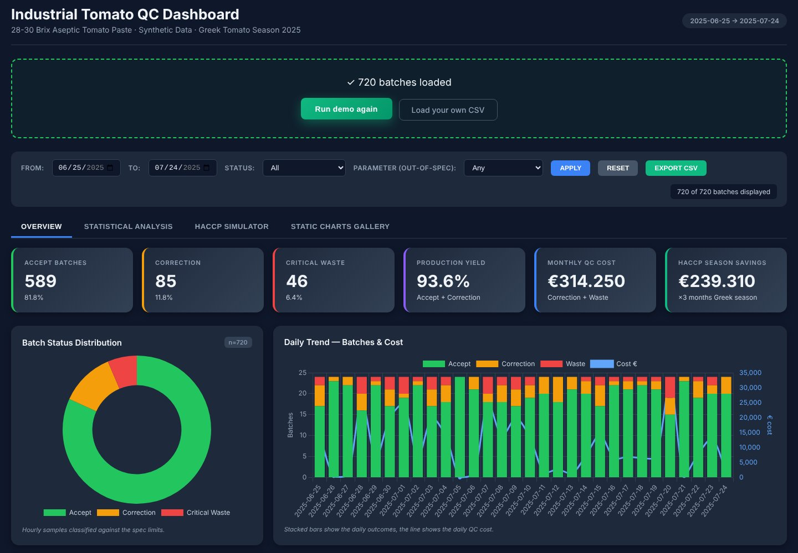
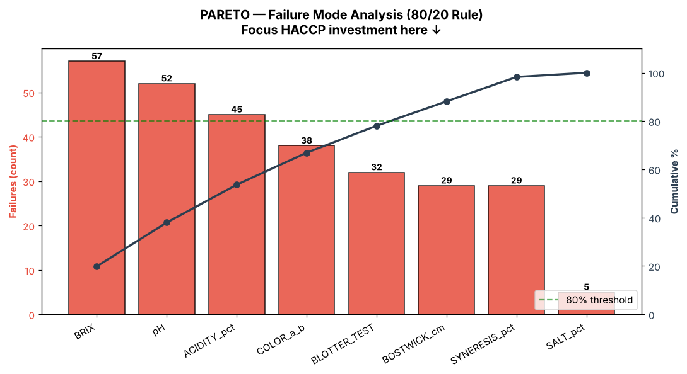
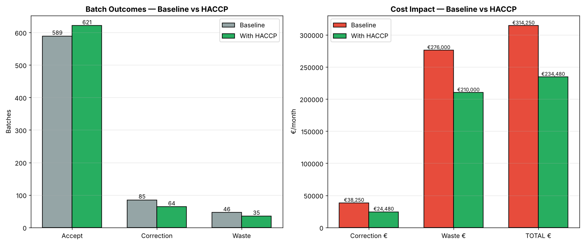

# Industrial Tomato Quality Control Pipeline

A Python project that checks the hourly lab samples of an aseptic tomato paste line against spec limits, classifies every batch and puts a euro value on quality failures. It is based on my season as a Quality Control Data Analyst at D. Nomikos S.A.

> **Disclaimer:** This project uses 100% synthetic production data and my own cost estimates, for methodology demonstration only. The spec limits are typical limits for 28-30 Brix aseptic tomato paste.

**Live dashboard:** [phytai.com/tomato-qc.html](https://phytai.com/tomato-qc.html) (click Run demo)



---

## Business Question

A tomato paste line runs 24 hours a day in season. Every hour the lab tests one sample on 8 parameters (Brix, pH, acidity, colour, Bostwick, blotter, syneresis, salt) and decides: ship the batch, correct it, or discard it.

**Which quality failures cost the most money, and where should quality control focus first?**

---

## Key Findings (one simulated month, 720 hourly batches)

| Outcome | Batches | Share | Cost per batch | Monthly cost |
|:--------|--------:|------:|---------------:|-------------:|
| Accept | 589 | 81.8% | €0 | €0 |
| Correction | 85 | 11.8% | €450 | €38,250 |
| Critical Waste | 46 | 6.4% | €6,000 | €276,000 |
| **Total** | **720** | **100%** | | **€314,250** |

- **Waste is 6.4% of batches but 88% of the failure cost.** One lost batch costs as much as 13 corrections, so the money is in catching the few severe batches early, not in the many small corrections.
- **Brix and pH drive the losses.** Brix (57 deviations) and pH (52) cause 38% of all deviations, and 36 of the 46 lost batches had a severe Brix or pH miss.
- **Brix fails only on the low side.** All 57 Brix failures are below the 28.0 minimum, because the line runs at about 28.5, near the bottom of the 28 to 30 range.
- **Five parameters cause 78% of all deviations** (Brix, pH, acidity, colour, blotter). Salt fails only 5 times.
- **Capability is low on every parameter.** No parameter reaches a Cpk of 1.0 (Brix is lowest at 0.29), so the process itself produces out-of-spec paste and more inspection alone will not fix it.

**What I would do:** add inline Brix and pH probes with alarms set inside the spec limits, so a drifting batch is corrected for €450 before it becomes a €6,000 loss, and test a slightly higher Brix target against the extra tomato and energy it needs.



---

## How It Works

| Step | What happens |
|:-----|:-------------|
| 1. Data | 720 hourly samples (24 per day for 30 days) on 8 parameters, generated with NumPy normal distributions (seed 42, so every run gives the same data) |
| 2. Check | Every value is compared with the spec limits below |
| 3. Classify | Each batch becomes Accept, Correction or Critical Waste (rules below) |
| 4. Cost | €0, €450 or €6,000 per batch |
| 5. Analyse | Pareto, SPC control charts (3-sigma), Cp/Cpk, failure heatmap, FMEA-style risk matrix |
| 6. Report | 6-sheet Excel report, 14 PNG charts and an interactive HTML dashboard |

**Decision rules**

- **Accept:** all 8 parameters within spec. Cost €0.
- **Correction:** 1 or 2 parameters out of spec. Cost €450 (citric acid dosing, labour, energy, QC, short downtime).
- **Critical Waste:** Brix or pH out of spec by more than 15% of the spec range, or 3 or more parameters out of spec. Cost €6,000 (lost batch €3,500, sanitization €800, investigation €400, disposal €300, downstream €800, non-conformance report €200).

---

## Spec Limits (28-30 Brix Aseptic Tomato Paste)

| Parameter | Min | Max | Target | Unit | What it measures |
|-----------|-----|-----|--------|------|-----------------|
| BRIX | 28.0 | 30.0 | 28.5 | % | Total soluble solids, paste concentration |
| COLOR a/b | 1.85 | 2.40 | 2.00 | ratio | Red to yellow colour ratio (Hunter Lab) |
| BOSTWICK | 2.0 | 6.0 | 4.0 | cm/30s | Viscosity, flow consistency |
| pH | 4.10 | 4.45 | 4.20 | | Acidity level, critical for food safety |
| ACIDITY | 0.0 | 8.0 | 6.5 | % | Titratable acidity |
| BLOTTER TEST | 0.0 | 5.0 | 3.0 | mm | Serum separation indicator |
| SYNERESIS | 0.0 | 6.0 | 4.0 | % | Water separation from paste |
| SALT | 1.5 | 2.5 | 2.0 | % | Sodium chloride content |

---

## Scenario: Stronger CCP Monitoring (HACCP / ISO 22000)

The scenario assumes tighter monitoring of the critical control points (inline probes, earlier alarms). The rates are my estimates from the factory season, not results of the model:

- 25% fewer correction and waste batches
- 15% lower cost per correction
- 3 production months per year (Greek tomato season)

| Metric | Baseline | Scenario | Change |
|:-------|---------:|---------:|-------:|
| Correction batches per month | 85 | 64 | -21 |
| Critical waste batches per month | 46 | 35 | -11 |
| Production yield (Accept + Correction) | 93.6% | 95.1% | +1.5 pp |
| Monthly failure cost | €314,250 | €234,480 | -€79,770 |
| **Savings per 3-month season** | | | **€239,310** |

The season savings already include €115,500 of batch value that is no longer lost (the €6,000 waste cost contains the €3,500 batch), so the two figures are not added together.

**Scale check:** Kyknos S.A., a Greek tomato processor, reported turnover of €36.3M and EBITDA of €2.4M for FY 2022-23 (year to June 2023). The scenario savings equal about 0.7% of that turnover and about 10% of that EBITDA.



---

## Charts Generated (14 total)

All charts are in the [`charts/`](charts) folder and inside the Excel report.

| # | Chart | What it shows |
|---|-------|--------------|
| 00 | Pipeline Flow | End-to-end architecture diagram |
| 01 | Status Distribution | Donut chart of Accept / Correction / Waste shares |
| 02 | Cost Breakdown | Monthly correction, waste and total cost |
| 03 | Daily Trend | Outcomes per day (stacked bars) and daily cost |
| 04 | Parameter Distributions | 8 histograms against the spec limits |
| 05 | HACCP Impact | Baseline against scenario, batches and cost |
| 06 | Pareto Analysis | Which parameters cause most failures (80/20) |
| 07 | Correlation Heatmap | Which parameters move together (Pearson r) |
| 08 | SPC Control Chart | Control limits at 3 sigma for pH and Brix |
| 09 | Process Capability | Cp / Cpk for all 8 parameters against the 1.0 and 1.33 benchmarks |
| 10 | Failure Heatmap | Failure cost by hour of day and day of month |
| 11 | Boxplots by Status | Parameter values for each batch outcome |
| 12 | ROI Break-Even | Payback of an assumed €35K monitoring investment |
| 13 | Risk Priority Matrix | FMEA-style frequency against severity |

---

## Project Evolution

**Phase 1, prototype** (`INDUSTRIAL ANOMALY DETECTION.ipynb`): single-parameter pH proof of concept on 480 batches with a simple if-elif-else classification. Built to test the business logic.

**Phase 2, full pipeline** (`generate_pipeline.py`): 720 hourly batches on 8 quality parameters, HACCP scenario, 14 charts and a multi-sheet Excel report.

**Phase 3, interactive dashboard** (`dashboard.html`): runs in the browser with filters, scenario sliders and CSV export. Live version: [phytai.com/tomato-qc.html](https://phytai.com/tomato-qc.html).

---

## Tools & Libraries

| Tool | Purpose |
|------|---------|
| Python 3 | Core language |
| pandas | Data manipulation and aggregation |
| NumPy | Synthetic data generation (normal distributions, fixed seed) |
| Matplotlib | Chart generation (14 PNG charts) |
| seaborn | Charts in the Phase 1 notebook |
| openpyxl | Excel report with embedded charts |
| Chart.js | Interactive charts in the dashboard |
| PapaParse | CSV parsing in the browser (dashboard) |

---

## How to Run

**One click:** double-click `run_pipeline.bat`. It installs the dependencies and generates all output files.

**Manual:**
```
py -3 generate_pipeline.py --regen
```

To view the dashboard, open `dashboard.html` in any browser and load `tomato_qc_data.csv`, or use the [live version](https://phytai.com/tomato-qc.html).

---

## Files

| File | Description |
|------|-------------|
| `generate_pipeline.py` | Main pipeline: data generation, classification, costing, 14 charts, Excel and CSV export |
| `dashboard.html` | Interactive web dashboard, opens locally in any browser |
| `run_pipeline.bat` | One-click runner (installs dependencies and runs the pipeline) |
| `tomato_qc_data.csv` | 720 hourly batch records with Status, Cost and Deviations columns |
| `tomato_qc_report.xlsx` | 6-sheet Excel report (hourly data, summary, spec limits, daily summary, HACCP scenario, charts) |
| `HACCP_Impact_Simulation.csv` | HACCP scenario table, written by the pipeline |
| `charts/` | 14 PNG charts |
| `INDUSTRIAL ANOMALY DETECTION.ipynb` | Phase 1 prototype, pH-only proof of concept |

---

## Sources

| Source | How it was used |
|--------|----------------|
| **Kyknos S.A. results, FY 2022-23** (year to June 2023, [as reported by ot.gr](https://www.ot.gr/2024/04/04/epixeiriseis/kyknos-ayksisi-tzirou-215-me-to-vlemma-se-nea-proionta-kai-eksagoges/)) | Scale check: turnover €36.3M, EBITDA €2.4M |
| **EU Tomato Paste Market Reports 2024-25** | Wholesale paste price reference: €1,150/tonne for 28-30 Brix aseptic paste, used for the batch value (3 t × €1,150 = €3,450, about €3,500) |
| **Spec limits** | Typical limits for 28-30 Brix aseptic tomato paste, from my QC work, for all 8 quality parameters (BRIX, COLOR, BOSTWICK, pH, ACIDITY, BLOTTER, SYNERESIS, SALT) |
| **Personal QC experience at D. Nomikos S.A.** | Cost estimates (correction €450, critical waste €6,000), scenario rates (25% fewer failures, 15% lower correction cost) and Greek tomato season length (3 months) |
